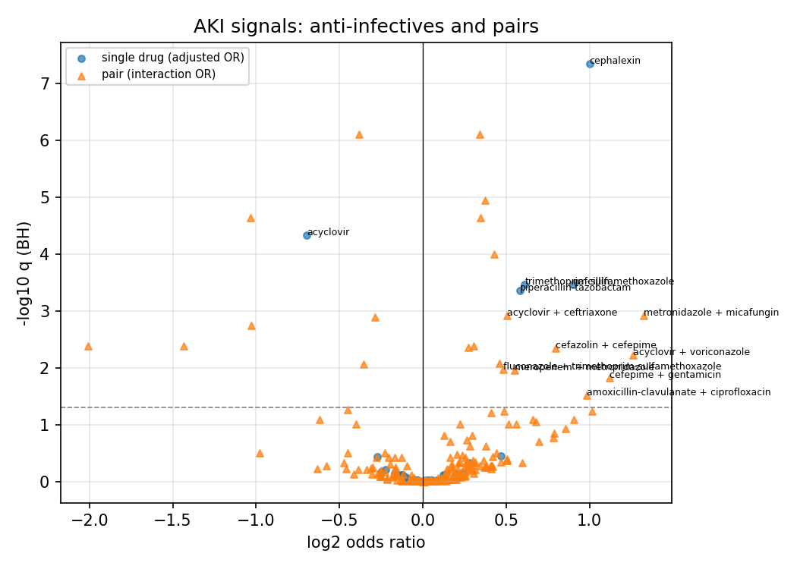
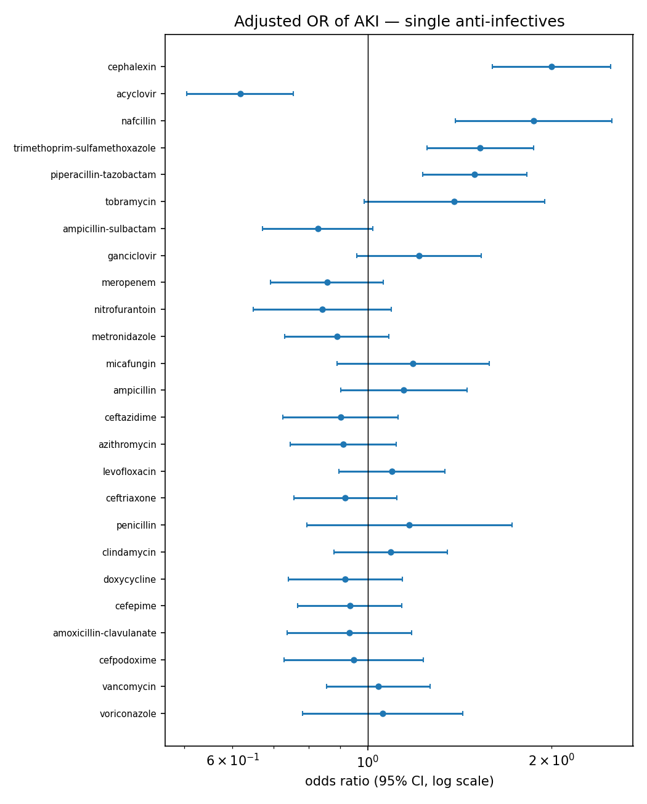
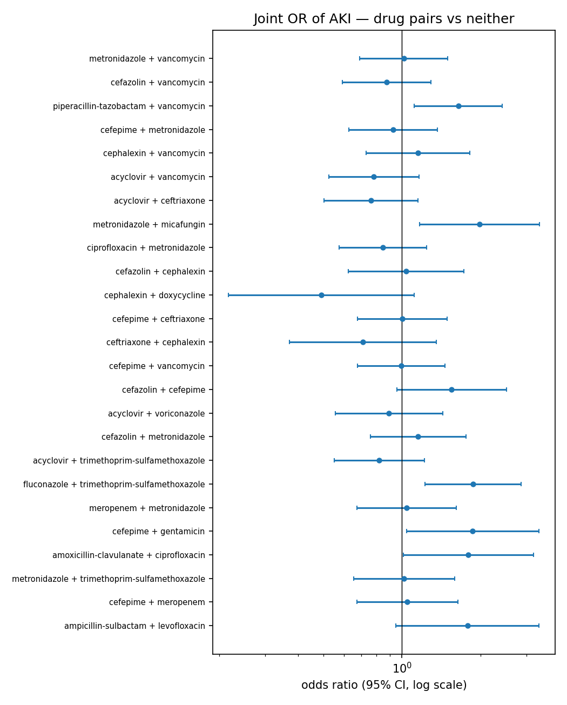
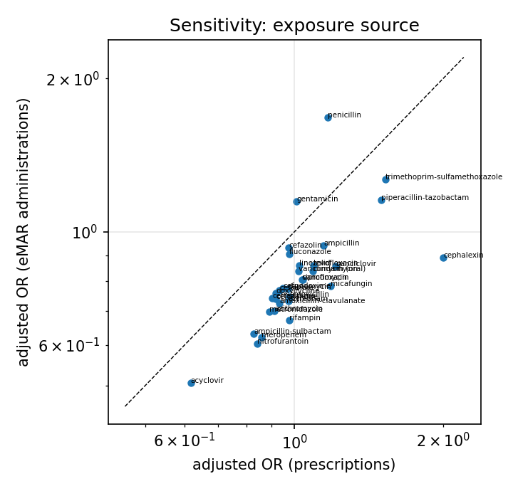

# Results — Drug-induced AKI signal detection (MIMIC-IV)

**Design:** active-comparator cohort. Every adult admission that received a systemic anti-infective is included, so
everyone is "being treated for an infection". t0 = first anti-infective; regimen = everything started within
24 h. **Outcome:** AKI by KDIGO creatinine criteria within 7 days
(≥ 1.5 × baseline, or ≥ +0.3 mg/dL within 48 h); baseline = lowest creatinine in the 7 days before t0.
Excluded: baseline creatinine ≥ 4.0 mg/dL and ESRD/dialysis codes.
**Exposure source:** `prescriptions`.

178,884 admissions (96,726 patients) · AKI 16.5% · stage ≥ 2 4.0% ·
46 anti-infectives seen, 35 with ≥ 200 exposures in the adjusted
model · 213 pairs with ≥ 100 co-exposures tested.

## Positive control (IPTW)

| | vancomycin + piperacillin-tazobactam | vancomycin + cefepime |
|---|---|---|
| admissions | 9,086 | 14,864 |
| crude AKI risk | 30.4% | 24.0% |
| IPTW AKI risk | 32.2% | 23.0% |

IPTW risk difference **+9.2%** (95% CI +8.0% to +10.2%),
odds ratio **1.59** (1.50–1.67); largest |SMD| after weighting
0.019 (< 0.1 = balanced). Published studies report more AKI with piperacillin-tazobactam than with
cefepime when combined with vancomycin; finding the same direction here is a sanity check of the pipeline.

## Single anti-infectives — adjusted odds ratios
Logistic regression with every drug plus age, sex, admission type, ICU at t0, baseline creatinine, number of
creatinine tests before and after t0, number of anti-infectives, nephrotoxic co-medications (NSAID, loop diuretic,
ACEi/ARB, vasopressor, calcineurin inhibitor, PPI, IV contrast, statin) and comorbidities. SEs are clustered by
patient. q = Benjamini–Hochberg (FDR 0.05). **5** drugs signal at q < 0.05.

| drug | n_exposed | aki_exposed | adj_or | ci_low | ci_high | q | signal |
|---|---|---|---|---|---|---|---|
| cephalexin | 3,435 | 712 | 2.000 | 1.599 | 2.501 | 0.000 | ↑ risk |
| acyclovir | 15,778 | 1,968 | 0.617 | 0.505 | 0.755 | 0.000 | ↓ risk |
| nafcillin | 495 | 121 | 1.869 | 1.391 | 2.512 | 0.000 | ↑ risk |
| trimethoprim-sulfamethoxazole | 13,769 | 2,639 | 1.529 | 1.249 | 1.871 | 0.000 | ↑ risk |
| piperacillin-tazobactam | 16,055 | 4,241 | 1.496 | 1.229 | 1.823 | 0.000 | ↑ risk |
| tobramycin | 314 | 115 | 1.386 | 0.986 | 1.947 | 0.351 |  |
| ampicillin-sulbactam | 8,146 | 806 | 0.827 | 0.672 | 1.018 | 0.367 |  |
| ganciclovir | 2,035 | 567 | 1.214 | 0.960 | 1.535 | 0.463 |  |
| meropenem | 4,395 | 854 | 0.857 | 0.693 | 1.060 | 0.606 |  |
| nitrofurantoin | 1,676 | 188 | 0.841 | 0.648 | 1.092 | 0.679 |  |
| metronidazole | 28,518 | 4,197 | 0.890 | 0.730 | 1.083 | 0.709 |  |
| micafungin | 532 | 159 | 1.185 | 0.889 | 1.580 | 0.709 |  |
| ampicillin | 2,086 | 318 | 1.145 | 0.903 | 1.453 | 0.709 |  |
| ceftazidime | 2,920 | 692 | 0.902 | 0.726 | 1.121 | 0.760 |  |
| azithromycin | 14,977 | 2,307 | 0.911 | 0.746 | 1.113 | 0.760 |  |
| levofloxacin | 11,863 | 1,906 | 1.094 | 0.896 | 1.337 | 0.760 |  |
| ceftriaxone | 37,429 | 5,737 | 0.918 | 0.756 | 1.116 | 0.760 |  |
| penicillin | 385 | 47 | 1.169 | 0.793 | 1.722 | 0.760 |  |
| clindamycin | 4,548 | 658 | 1.090 | 0.879 | 1.350 | 0.760 |  |
| doxycycline | 4,282 | 637 | 0.918 | 0.741 | 1.138 | 0.760 |  |
| cefepime | 21,150 | 4,811 | 0.934 | 0.767 | 1.137 | 0.823 |  |
| amoxicillin-clavulanate | 2,785 | 285 | 0.933 | 0.738 | 1.179 | 0.891 |  |
| cefpodoxime | 1,476 | 184 | 0.948 | 0.729 | 1.233 | 0.925 |  |
| vancomycin | 56,448 | 12,522 | 1.040 | 0.856 | 1.264 | 0.925 |  |
| voriconazole | 593 | 117 | 1.057 | 0.781 | 1.430 | 0.925 |  |
| ciprofloxacin | 25,957 | 3,502 | 1.036 | 0.851 | 1.261 | 0.925 |  |
| cefazolin | 28,162 | 4,796 | 0.975 | 0.800 | 1.188 | 0.925 |  |
| daptomycin | 1,335 | 261 | 0.969 | 0.754 | 1.246 | 0.925 |  |
| fluconazole | 4,654 | 937 | 0.978 | 0.791 | 1.208 | 0.925 |  |
| aztreonam | 732 | 158 | 0.972 | 0.733 | 1.289 | 0.925 |  |
| vancomycin (oral) | 4,609 | 866 | 1.021 | 0.826 | 1.262 | 0.925 |  |
| linezolid | 1,487 | 323 | 1.022 | 0.800 | 1.305 | 0.925 |  |
| amoxicillin | 980 | 141 | 0.978 | 0.739 | 1.293 | 0.925 |  |
| rifampin | 390 | 60 | 0.977 | 0.678 | 1.406 | 0.925 |  |
| gentamicin | 1,645 | 203 | 1.010 | 0.786 | 1.300 | 0.935 |  |

AKI stage ≥ 2 (more specific outcome):

| drug | n_exposed | adj_or | ci_low | ci_high | q | signal |
|---|---|---|---|---|---|---|
| cephalexin | 3,435 | 4.242 | 3.006 | 5.985 | 0.000 | ↑ risk |
| acyclovir | 15,778 | 0.416 | 0.301 | 0.575 | 0.000 | ↓ risk |
| cefazolin | 28,162 | 0.637 | 0.466 | 0.871 | 0.056 |  |
| azithromycin | 14,977 | 0.663 | 0.482 | 0.911 | 0.097 |  |
| doxycycline | 4,282 | 0.639 | 0.447 | 0.913 | 0.097 |  |
| ampicillin-sulbactam | 8,146 | 0.694 | 0.497 | 0.970 | 0.174 |  |
| cefepime | 21,150 | 0.726 | 0.534 | 0.988 | 0.174 |  |
| meropenem | 4,395 | 0.709 | 0.505 | 0.994 | 0.174 |  |
| aztreonam | 732 | 0.610 | 0.375 | 0.993 | 0.174 |  |
| nafcillin | 495 | 1.605 | 1.001 | 2.574 | 0.174 |  |
| linezolid | 1,487 | 0.676 | 0.453 | 1.009 | 0.176 |  |
| ceftazidime | 2,920 | 0.733 | 0.521 | 1.029 | 0.213 |  |
| metronidazole | 28,518 | 0.766 | 0.561 | 1.044 | 0.247 |  |
| tobramycin | 314 | 0.665 | 0.399 | 1.110 | 0.278 |  |
| amoxicillin-clavulanate | 2,785 | 0.716 | 0.470 | 1.091 | 0.278 |  |
| nitrofurantoin | 1,676 | 0.689 | 0.424 | 1.117 | 0.278 |  |
| fluconazole | 4,654 | 0.773 | 0.552 | 1.084 | 0.278 |  |
| levofloxacin | 11,863 | 0.795 | 0.579 | 1.092 | 0.304 |  |
| gentamicin | 1,645 | 0.756 | 0.498 | 1.147 | 0.347 |  |
| amoxicillin | 980 | 0.700 | 0.401 | 1.219 | 0.363 |  |
| ceftriaxone | 37,429 | 0.829 | 0.610 | 1.127 | 0.375 |  |
| piperacillin-tazobactam | 16,055 | 1.205 | 0.885 | 1.640 | 0.375 |  |
| rifampin | 390 | 0.649 | 0.312 | 1.349 | 0.375 |  |
| trimethoprim-sulfamethoxazole | 13,769 | 0.852 | 0.616 | 1.178 | 0.484 |  |
| ampicillin | 2,086 | 1.167 | 0.799 | 1.705 | 0.593 |  |
| daptomycin | 1,335 | 0.854 | 0.563 | 1.295 | 0.616 |  |
| vancomycin (oral) | 4,609 | 0.903 | 0.644 | 1.267 | 0.719 |  |
| ciprofloxacin | 25,957 | 0.942 | 0.689 | 1.286 | 0.881 |  |
| clindamycin | 4,548 | 0.964 | 0.682 | 1.364 | 0.947 |  |
| vancomycin | 56,448 | 0.969 | 0.714 | 1.315 | 0.947 |  |
| cefpodoxime | 1,476 | 0.949 | 0.565 | 1.596 | 0.947 |  |
| ganciclovir | 2,035 | 0.967 | 0.654 | 1.430 | 0.947 |  |
| penicillin | 385 | 1.047 | 0.538 | 2.036 | 0.947 |  |
| voriconazole | 593 | 0.984 | 0.605 | 1.602 | 0.978 |  |
| micafungin | 532 | 1.001 | 0.649 | 1.544 | 0.997 |  |

## Drug pairs — interaction
`interaction_or` > 1: the pair carries more risk than the two drugs' own effects multiplied. `joint_or` = the pair
vs neither drug. **22** pairs signal at q < 0.05.

| drug_a | drug_b | n_pair | aki_pair | interaction_or | ci_low | ci_high | joint_or | q | signal |
|---|---|---|---|---|---|---|---|---|---|
| metronidazole | vancomycin | 10,763 | 2,345 | 1.269 | 1.171 | 1.376 | 1.016 | 0.000 | synergy ↑ |
| cefazolin | vancomycin | 5,788 | 1,679 | 0.768 | 0.702 | 0.840 | 0.874 | 0.000 | less than expected |
| piperacillin-tazobactam | vancomycin | 10,606 | 3,231 | 1.295 | 1.176 | 1.427 | 1.645 | 0.000 | synergy ↑ |
| cefepime | metronidazole | 6,363 | 1,531 | 1.272 | 1.158 | 1.398 | 0.927 | 0.000 | synergy ↑ |
| cephalexin | vancomycin | 653 | 84 | 0.488 | 0.369 | 0.646 | 1.152 | 0.000 | less than expected |
| acyclovir | vancomycin | 4,039 | 653 | 1.345 | 1.188 | 1.522 | 0.781 | 0.000 | synergy ↑ |
| acyclovir | ceftriaxone | 2,154 | 271 | 1.420 | 1.201 | 1.679 | 0.761 | 0.001 | synergy ↑ |
| metronidazole | micafungin | 145 | 64 | 2.508 | 1.612 | 3.902 | 1.984 | 0.001 | synergy ↑ |
| ciprofloxacin | metronidazole | 12,041 | 1,225 | 0.820 | 0.744 | 0.903 | 0.846 | 0.001 | less than expected |
| cefazolin | cephalexin | 437 | 47 | 0.490 | 0.344 | 0.699 | 1.037 | 0.002 | less than expected |
| cephalexin | doxycycline | 135 | 10 | 0.249 | 0.119 | 0.521 | 0.492 | 0.004 | less than expected |
| cefepime | ceftriaxone | 2,819 | 655 | 1.234 | 1.103 | 1.381 | 1.004 | 0.004 | synergy ↑ |
| ceftriaxone | cephalexin | 167 | 17 | 0.370 | 0.217 | 0.630 | 0.710 | 0.004 | less than expected |
| cefepime | vancomycin | 16,384 | 4,029 | 1.208 | 1.091 | 1.337 | 0.995 | 0.004 | synergy ↑ |
| cefazolin | cefepime | 258 | 91 | 1.739 | 1.287 | 2.349 | 1.551 | 0.004 | synergy ↑ |
| acyclovir | voriconazole | 354 | 82 | 2.398 | 1.472 | 3.905 | 0.891 | 0.006 | synergy ↑ |
| cefazolin | metronidazole | 1,029 | 192 | 1.374 | 1.145 | 1.650 | 1.154 | 0.008 | synergy ↑ |
| acyclovir | trimethoprim-sulfamethoxazole | 3,492 | 466 | 0.782 | 0.679 | 0.902 | 0.819 | 0.009 | less than expected |
| fluconazole | trimethoprim-sulfamethoxazole | 1,069 | 328 | 1.397 | 1.146 | 1.702 | 1.871 | 0.011 | synergy ↑ |
| meropenem | metronidazole | 596 | 161 | 1.463 | 1.166 | 1.836 | 1.044 | 0.011 | synergy ↑ |
| cefepime | gentamicin | 107 | 38 | 2.172 | 1.347 | 3.505 | 1.866 | 0.015 | synergy ↑ |
| amoxicillin-clavulanate | ciprofloxacin | 209 | 30 | 1.978 | 1.258 | 3.109 | 1.797 | 0.030 | synergy ↑ |
| metronidazole | trimethoprim-sulfamethoxazole | 739 | 126 | 0.732 | 0.586 | 0.913 | 1.020 | 0.053 |  |
| cefepime | meropenem | 529 | 144 | 1.401 | 1.099 | 1.786 | 1.050 | 0.058 |  |
| ampicillin-sulbactam | levofloxacin | 118 | 26 | 2.019 | 1.214 | 3.358 | 1.782 | 0.058 |  |
| acyclovir | azithromycin | 850 | 129 | 1.328 | 1.078 | 1.635 | 0.720 | 0.062 |  |
| cephalexin | trimethoprim-sulfamethoxazole | 394 | 63 | 0.652 | 0.470 | 0.903 | 2.115 | 0.080 |  |
| acyclovir | clindamycin | 156 | 29 | 1.873 | 1.158 | 3.030 | 1.217 | 0.081 |  |
| azithromycin | meropenem | 208 | 59 | 1.581 | 1.111 | 2.250 | 1.184 | 0.081 |  |
| ampicillin-sulbactam | fluconazole | 207 | 61 | 1.602 | 1.107 | 2.319 | 1.239 | 0.088 |  |
| azithromycin | cefepime | 2,679 | 644 | 1.167 | 1.032 | 1.321 | 0.941 | 0.097 |  |
| acyclovir | meropenem | 418 | 85 | 1.428 | 1.073 | 1.900 | 0.722 | 0.097 |  |
| cefepime | linezolid | 380 | 105 | 1.477 | 1.078 | 2.024 | 1.253 | 0.097 |  |
| acyclovir | ciprofloxacin | 870 | 107 | 0.758 | 0.605 | 0.949 | 0.495 | 0.097 |  |
| acyclovir | ampicillin-sulbactam | 162 | 19 | 1.811 | 1.103 | 2.973 | 0.907 | 0.115 |  |
| micafungin | piperacillin-tazobactam | 123 | 57 | 1.725 | 1.075 | 2.767 | 2.615 | 0.141 |  |
| ceftriaxone | vancomycin | 9,825 | 1,775 | 1.092 | 1.010 | 1.181 | 0.999 | 0.151 |  |
| vancomycin | vancomycin (oral) | 1,266 | 349 | 1.226 | 1.024 | 1.470 | 1.208 | 0.151 |  |
| ampicillin | clindamycin | 193 | 31 | 1.724 | 1.052 | 2.826 | 2.026 | 0.168 |  |
| ceftriaxone | trimethoprim-sulfamethoxazole | 1,174 | 232 | 1.200 | 1.013 | 1.421 | 1.642 | 0.184 |  |

## Penalised all-exposure model
One L2-shrunk model with every drug and pair (≥ 50 exposures). Pair rows are interaction terms.

| exposure | kind | n_exposed | shrunk_or |
|---|---|---|---|
| cefazolin + cefepime | pair (interaction) | 258 | 1.460 |
| fluconazole + trimethoprim-sulfamethoxazole | pair (interaction) | 1,069 | 1.348 |
| cefepime + ceftriaxone | pair (interaction) | 2,819 | 1.246 |
| amoxicillin-clavulanate + ciprofloxacin | pair (interaction) | 209 | 1.244 |
| piperacillin-tazobactam + vancomycin | pair (interaction) | 10,606 | 1.210 |
| metronidazole + micafungin | pair (interaction) | 145 | 1.202 |
| metronidazole + vancomycin | pair (interaction) | 10,763 | 1.198 |
| cephalexin | drug | 3,435 | 1.186 |
| acyclovir + vancomycin | pair (interaction) | 4,039 | 1.184 |
| ampicillin-sulbactam + levofloxacin | pair (interaction) | 118 | 1.183 |
| acyclovir + ceftriaxone | pair (interaction) | 2,154 | 1.182 |
| cefazolin + metronidazole | pair (interaction) | 1,029 | 1.174 |
| cefepime + gentamicin | pair (interaction) | 107 | 1.170 |
| cefepime + meropenem | pair (interaction) | 529 | 1.167 |
| acyclovir + linezolid | pair (interaction) | 102 | 1.165 |
| acyclovir + clindamycin | pair (interaction) | 156 | 1.164 |
| azithromycin + meropenem | pair (interaction) | 208 | 1.160 |
| ampicillin + clindamycin | pair (interaction) | 193 | 1.158 |
| ampicillin-sulbactam + fluconazole | pair (interaction) | 207 | 1.143 |
| acyclovir + ampicillin-sulbactam | pair (interaction) | 162 | 1.141 |
| ceftriaxone + trimethoprim-sulfamethoxazole | pair (interaction) | 1,174 | 1.140 |
| metronidazole + nitrofurantoin | pair (interaction) | 51 | 1.138 |
| micafungin + piperacillin-tazobactam | pair (interaction) | 123 | 1.138 |
| acyclovir + voriconazole | pair (interaction) | 354 | 1.137 |
| cefepime + linezolid | pair (interaction) | 380 | 1.136 |
| doxycycline + piperacillin-tazobactam | pair (interaction) | 218 | 1.133 |
| doxycycline + meropenem | pair (interaction) | 92 | 1.121 |
| meropenem + metronidazole | pair (interaction) | 596 | 1.117 |
| ampicillin-sulbactam + vancomycin (oral) | pair (interaction) | 64 | 1.114 |
| gentamicin + piperacillin-tazobactam | pair (interaction) | 93 | 1.102 |

## Sensitivity: eMAR administrations instead of prescriptions
| drug | adj_or_rx | adj_or_emar | n_exposed |
|---|---|---|---|
| cephalexin | 2.000 | 0.889 | 1,459 |
| acyclovir | 0.617 | 0.505 | 9,130 |
| trimethoprim-sulfamethoxazole | 1.529 | 1.267 | 6,854 |
| piperacillin-tazobactam | 1.496 | 1.155 | 12,327 |
| ampicillin-sulbactam | 0.827 | 0.631 | 4,283 |
| ganciclovir | 1.214 | 0.855 | 1,274 |
| meropenem | 0.857 | 0.621 | 2,694 |
| nitrofurantoin | 0.841 | 0.603 | 1,163 |
| metronidazole | 0.890 | 0.698 | 17,737 |
| micafungin | 1.185 | 0.784 | 293 |
| ampicillin | 1.145 | 0.941 | 1,037 |
| ceftazidime | 0.902 | 0.743 | 2,072 |
| azithromycin | 0.911 | 0.699 | 11,515 |
| levofloxacin | 1.094 | 0.859 | 4,594 |
| ceftriaxone | 0.918 | 0.738 | 31,379 |
| penicillin | 1.169 | 1.676 | 342 |
| clindamycin | 1.090 | 0.838 | 2,842 |
| doxycycline | 0.918 | 0.757 | 3,089 |
| cefepime | 0.934 | 0.769 | 16,053 |
| amoxicillin-clavulanate | 0.933 | 0.726 | 1,465 |
| cefpodoxime | 0.948 | 0.777 | 800 |
| vancomycin | 1.040 | 0.806 | 34,825 |
| ciprofloxacin | 1.036 | 0.807 | 10,913 |
| cefazolin | 0.975 | 0.932 | 17,577 |
| daptomycin | 0.969 | 0.774 | 761 |
| fluconazole | 0.978 | 0.904 | 2,090 |
| aztreonam | 0.972 | 0.731 | 277 |
| vancomycin (oral) | 1.021 | 0.838 | 2,738 |
| linezolid | 1.022 | 0.859 | 836 |
| amoxicillin | 0.978 | 0.745 | 440 |
| rifampin | 0.977 | 0.671 | 214 |
| gentamicin | 1.010 | 1.149 | 652 |

## Crude risks
| drug | n_exposed | aki_exposed | risk_exposed | risk_unexposed | crude_rr |
|---|---|---|---|---|---|
| vancomycin | 56,448 | 12,522 | 0.222 | 0.139 | 1.599 |
| ceftriaxone | 37,429 | 5,737 | 0.153 | 0.168 | 0.912 |
| metronidazole | 28,518 | 4,197 | 0.147 | 0.168 | 0.874 |
| cefazolin | 28,162 | 4,796 | 0.170 | 0.164 | 1.039 |
| ciprofloxacin | 25,957 | 3,502 | 0.135 | 0.170 | 0.793 |
| cefepime | 21,150 | 4,811 | 0.227 | 0.157 | 1.453 |
| piperacillin-tazobactam | 16,055 | 4,241 | 0.264 | 0.155 | 1.702 |
| acyclovir | 15,778 | 1,968 | 0.125 | 0.169 | 0.739 |
| azithromycin | 14,977 | 2,307 | 0.154 | 0.166 | 0.928 |
| trimethoprim-sulfamethoxazole | 13,769 | 2,639 | 0.192 | 0.163 | 1.178 |
| levofloxacin | 11,863 | 1,906 | 0.161 | 0.165 | 0.972 |
| ampicillin-sulbactam | 8,146 | 806 | 0.099 | 0.168 | 0.589 |
| fluconazole | 4,654 | 937 | 0.201 | 0.164 | 1.228 |
| vancomycin (oral) | 4,609 | 866 | 0.188 | 0.164 | 1.143 |
| clindamycin | 4,548 | 658 | 0.145 | 0.165 | 0.874 |
| meropenem | 4,395 | 854 | 0.194 | 0.164 | 1.183 |
| doxycycline | 4,282 | 637 | 0.149 | 0.165 | 0.900 |
| cephalexin | 3,435 | 712 | 0.207 | 0.164 | 1.263 |
| ceftazidime | 2,920 | 692 | 0.237 | 0.164 | 1.447 |
| amoxicillin-clavulanate | 2,785 | 285 | 0.102 | 0.166 | 0.617 |
| ampicillin | 2,086 | 318 | 0.152 | 0.165 | 0.923 |
| ganciclovir | 2,035 | 567 | 0.279 | 0.164 | 1.703 |
| nitrofurantoin | 1,676 | 188 | 0.112 | 0.165 | 0.678 |
| gentamicin | 1,645 | 203 | 0.123 | 0.165 | 0.746 |
| linezolid | 1,487 | 323 | 0.217 | 0.165 | 1.320 |
| cefpodoxime | 1,476 | 184 | 0.125 | 0.165 | 0.754 |
| daptomycin | 1,335 | 261 | 0.196 | 0.165 | 1.187 |
| amoxicillin | 980 | 141 | 0.144 | 0.165 | 0.872 |
| aztreonam | 732 | 158 | 0.216 | 0.165 | 1.310 |
| voriconazole | 593 | 117 | 0.197 | 0.165 | 1.197 |
| micafungin | 532 | 159 | 0.299 | 0.165 | 1.816 |
| nafcillin | 495 | 121 | 0.244 | 0.165 | 1.484 |
| rifampin | 390 | 60 | 0.154 | 0.165 | 0.933 |
| penicillin | 385 | 47 | 0.122 | 0.165 | 0.740 |
| tobramycin | 314 | 115 | 0.366 | 0.165 | 2.225 |
| imipenem | 168 | 35 | 0.208 | 0.165 | 1.263 |
| oxacillin | 149 | 18 | 0.121 | 0.165 | 0.732 |
| ertapenem | 123 | 15 | 0.122 | 0.165 | 0.739 |
| tigecycline | 96 | 19 | 0.198 | 0.165 | 1.200 |
| moxifloxacin | 94 | 19 | 0.202 | 0.165 | 1.225 |

---
Signals are **hypotheses**, not proof of causation: residual confounding by indication and severity remains, and
creatinine is only measured when clinicians order it. Runtime 10.7 min. Aggregate results only; rows
with fewer than 10 patients are removed; no patient-level data or model weights in this repo.
